# Metal Gear Bandicoot

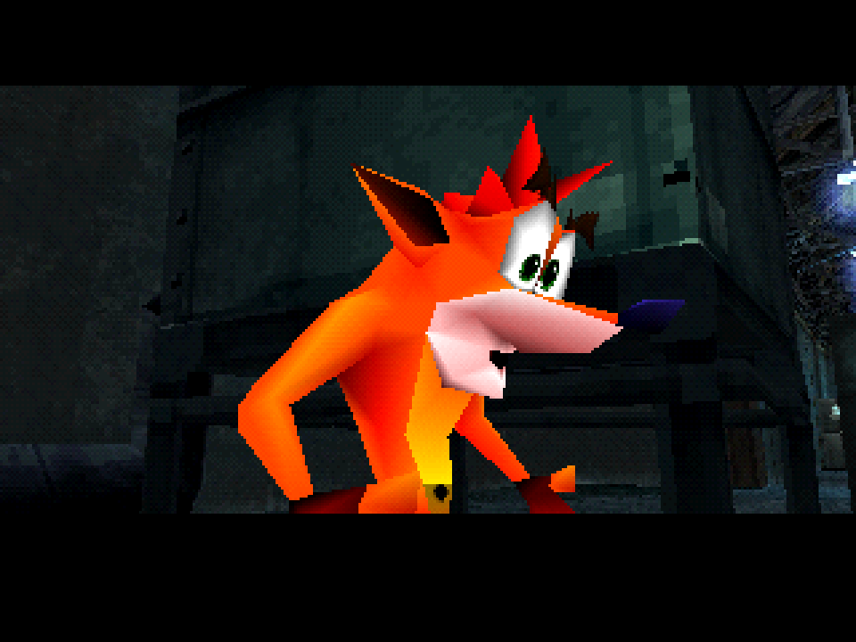

<sub>O jogo rodando: o Crash do Warped na cena de abertura do Loading Dock, do Metal Gear Solid.</sub>

**Uma fusão de dois jogos de PlayStation: o Crash Bandicoot jogável dentro do _Metal Gear Solid_, se escondendo na caixa dele, girando nos guardas e atirando Wumpa de bazuca.**

Um projeto de **[mrxploud](https://github.com/mrxploud)** ([ByteMirage](https://www.youtube.com/@ByteMirage)), feito em parceria com o Claude (dois deles, trabalhando ao mesmo tempo).

[**Discord**](https://discord.com/invite/4H5hGwVnPn) · [**YouTube (ByteMirage)**](https://www.youtube.com/@ByteMirage) · [**Baixar o projeto (.zip)**](https://github.com/mrxploud/Metal-Gear-Bandicoot/archive/refs/heads/main.zip)

No [Sonic Mirage](https://github.com/mrxploud/Sonic-Mirage), a fusão anterior, os dois jogos rodavam lado a lado em emuladores e nenhum foi aberto. Aqui é o contrário: **os dois jogos foram abertos por dentro.** O Metal Gear Solid é recompilado a partir da descompilação dele, com código novo dentro; o Crash é tirado do disco dele, vértice por vértice, e desenhado no lugar do Snake.

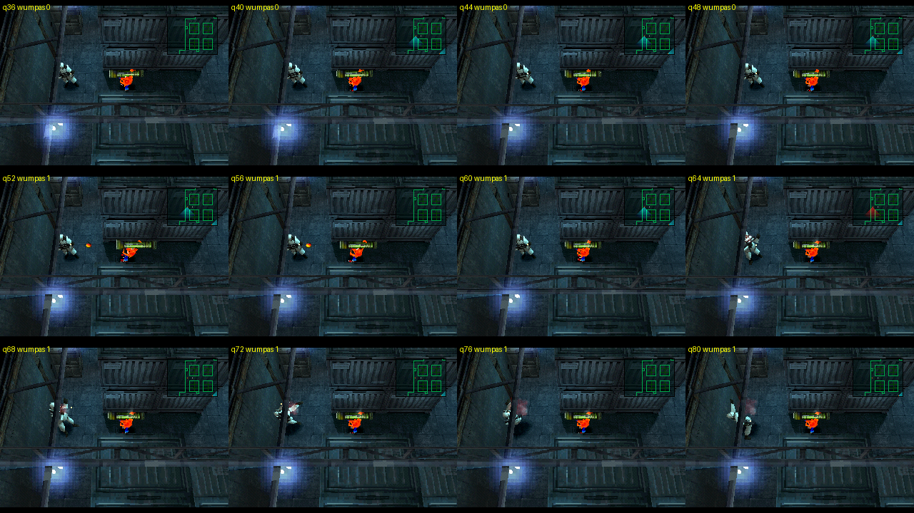

<sub>Teste 8: o Crash saca a bazuca, atira uma Wumpa e o guarda leva o golpe.</sub>

### De onde veio a ideia

Em dezembro de 2018, **u/Max_Comix** postou no r/crashbandicoot um desenho antigo dele: ["Metal Gear Bandicoot: Wumpa Fruit Eater"](https://www.reddit.com/r/crashbandicoot/comments/a5ofbf/i_found_this_old_crash_bandicoot_metal_gear_solid/). Nos comentários, **yuvi3000** sugeriu que o Crash se escondesse numa caixa do próprio Crash, outra pessoa pediu que o "!" dos guardas virasse "Woah!", e **ZXE102R** completou: "Honestly we need a woah mod for metal gear solid now."

Oito anos depois, mrxploud achou o post por acaso, enquanto escolhia dois jogos de PS1 já descompilados para a próxima fusão, e decidiu realizar o sonho daquele post. A caixa do Crash, o "WOAH!" e o resto estão aqui.

> [!WARNING]
> **Este projeto não está finalizado.** Só o Loading Dock (a primeira área do jogo) tem o Crash funcionando, o lado do Metal Gear Solid ainda está em andamento, e os testes 6, 7 e 8 foram conferidos só pelo robô de testes. A lista honesta do que funciona e do que não funciona está [mais abaixo](#estado-atual).

> [!IMPORTANT]
> **Este repositório não contém jogos, discos, BIOS nem emuladores**, só código e capturas de tela. Também não contém nada tirado dos discos (modelos, animações, texturas, sons): o extrator está aqui, o que ele extrai não. Para rodar você precisa das suas próprias cópias dos três discos, nas versões exatas listadas em [`discs/LEIA-ME.md`](discs/LEIA-ME.md).

---

## Índice

- [Estado atual](#estado-atual)
- [Como rodar](#como-rodar)
- [Controles](#controles)
- [Como funciona](#como-funciona)
- [A jornada, passo a passo](#a-jornada-passo-a-passo)
- [Os formatos do Crash](#os-formatos-do-crash)
- [Estrutura do projeto](#estrutura-do-projeto)
- [Comunidade](#comunidade)
- [Créditos e avisos](#créditos-e-avisos)

---

## Estado atual

O retrato é o do **teste 8** (11/10/2026). mrxploud foi jogando as versões e cada rodada dele virou o teste seguinte; a última rodada registrada no diário é a do teste 5. Os consertos e as novidades dos testes 6, 7 e 8 foram conferidos pelo robô de testes (um emulador dirigido por script).

### Funciona

- **O Crash do _Crash Bandicoot 3: Warped_ no lugar do Snake**, no Loading Dock, com as animações do próprio jogo dele: parado (respira e olha em volta), correndo, agachado, **engatinhando**, **derrapando**, o giro, o susto ao levar tiro e a morte.
- **A caixa do Crash** no lugar da caixa de papelão: A é a de madeira, B a "?" e C a TNT. O Crash some dentro dela.
- **A TNT:** com a caixa C parada no caminho, o guarda chuta; ela desliza contando 3, 2, 1 e explode.
- **"WOAH!":** quando um guarda vê o Crash, aparece "WOAH!" em cima da cabeça dele no lugar do "!", e ele grita o "Woah!" do Crash. O "?" virou "WOAH?".
- **O giro derruba quem estiver em volta**, não só na frente. A derrapada também derruba.
- **Aku Aku:** as três rações do Dock viraram caixas do Aku Aku. A primeira máscara absorve um tiro, a dourada dois, e a terceira vai para o rosto do Crash: 20 segundos invencível, e guarda que encostar cai.
- **A bazuca de Wumpa:** segurar o botão da arma saca a bazuca (dá para andar mirando), soltar atira uma Wumpa que voa reto; o guarda que ela acertar leva o golpe e cambaleia.
- Rádio, primeira pessoa, pausa e menus do Metal Gear Solid continuam funcionando.

### Não funciona ou não foi feito

- **Só o Loading Dock.** As outras áreas do jogo existem na descompilação, mas ninguém levou o Crash até lá.
- Sem tela de título própria e sem o Game Over "CRASH? CRAAASH!".
- Os guardas continuam sendo os do Metal Gear Solid (a ideia de virarem os assistentes de laboratório do Cortex ficou no papel).
- A Wumpa da bazuca não quebra caixa.
- Agachado, o botão do giro não faz nada (no MGS1 o Snake também não soca agachado).
- O Crash não pisca. Ele tem 64 "caras" no disco; só a de olhos abertos é usada.
- Saíram do disco e ainda não entraram no jogo: a morte do anjinho, a dança da vitória, o ioiô de quando ele fica parado, o Crash de mergulhador.
- O Integral é a versão japonesa: vozes em inglês, legendas e rádio em japonês.

### Limitações conhecidas

- **A memória do PlayStation (2 MB) está no limite.** No pior caso medido no Dock sobram 16 KB. A bazuca não cabe na memória fixa: ela é lida do CD quando o Crash saca (a primeira vez demora um instante) e devolvida 10 segundos depois de guardada.
- **Duas texturas não são o dado do disco:** a cara do Aku Aku na caixa e a Wumpa têm 256 cores no Warped e foram reduzidas para 16, porque a área de vídeo livre do Metal Gear Solid não comporta uma paleta de 256. A redução é nossa.
- Três sons (o "Woah!", o giro e o bipe da TNT) ainda vêm do Crash 1; o resto vem do Warped.
- O som do tiro da bazuca foi escolhido sem ninguém ouvir (ver [a jornada](#14-a-bazuca-o-crash-cortado-ao-meio)). Pode não ser o certo.

### Decisões de projeto (não vêm de nenhum dos dois jogos)

Onde as regras dos dois jogos não se encontram, foi preciso escolher:

- **O Snake continua lá, invisível.** Controle, colisão, guardas, alerta, câmera e rádio são os do Metal Gear Solid; o Crash é só o corpo que aparece.
- **O soco virou o giro**, e acerta em círculo em volta do Crash.
- **Correr + agachar virou a derrapada.** No MGS1 esse comando só agachava e deitava; a derrapada é um estado novo do Snake.
- **As rações viraram Aku Aku** (pedido de mrxploud): em vez de curar, a máscara absorve golpes, e a terceira dá invencibilidade com "toque da morte".
- **A bazuca funciona sem arma equipada** (no Dock o Snake não tem arma), e a fruta golpeia o guarda em vez de matar.
- **O "!" virou "WOAH!"**, escrito em letras laranja e amarelas geradas por nós.

---

## Como rodar

Testado apenas em **Windows 11**, com **Python 3.12**. São mais passos que no Sonic Mirage, porque aqui um jogo é extraído e o outro é recompilado.

> [!NOTE]
> Os passos 3, 4 e 6 são do lado do Metal Gear Solid, que ainda está em andamento. Eles descrevem o caminho usado até o teste 8 e vão ser revisados.

### 0. Baixar

```bash
git clone https://github.com/mrxploud/Metal-Gear-Bandicoot.git
```

### 1. Dependências

```bash
pip install -r requirements.txt
```

`numpy`, `Pillow` e `pygame`.

### 2. Os discos

Três discos de PlayStation, em `.bin` + `.cue`, nas versões exatas de [`discs/LEIA-ME.md`](discs/LEIA-ME.md):

| Jogo | Código |
|---|---|
| Metal Gear Solid: Integral, disco 1 (Japão) | SLPM-86247 |
| Crash Bandicoot 3: Warped (Europa) | SCES-01420 |
| Crash Bandicoot (EUA) | SCUS-94900 |

### 3. A descompilação do Metal Gear Solid

Clone os projetos de [`repos/LEIA-ME.md`](repos/LEIA-ME.md) dentro de `repos/`, prepare o `mgs_reversing` como o README dele ensina (compilador PsyQ, requisitos do `build/`) e aplique as nossas mudanças como está em [`mgs/LEIA-ME.md`](mgs/LEIA-ME.md).

### 4. Ferramentas

| O quê | Onde deixar |
|---|---|
| [mkpsxiso](https://github.com/Lameguy64/mkpsxiso) 2.30 (`dumpsxiso.exe` e `mkpsxiso.exe`) | `motor/tools/mkpsxiso/mkpsxiso-2.30-win64/` |
| núcleo [PCSX ReARMed](https://buildbot.libretro.com/nightly/windows/x86_64/latest/) do libretro (`pcsx_rearmed_libretro.dll`) | `motor/tools/core/` |

Não é preciso BIOS de PlayStation: o PCSX ReARMed tem uma embutida.

### 5. Tirar o Crash dos discos

```bash
python -I crash_assets/extrair3.py --disco "discs/<pasta do Warped>/<...>.cue"
python -I crash_assets/extrair.py  --disco "discs/<pasta do Crash 1>/<...>.cue"
python -I crash_assets/ver3.py --conferir
```

O primeiro grava `crash_assets/out_c3/` (292 animações, 90 modelos, 394 sons, em poucos segundos; as prévias em GIF levam alguns minutos, e `--sem-previas` pula). O terceiro confere a extração inteira sem abrir o disco.

### 6. Empacotar, compilar e montar o disco

```bash
python -I motor/empacotar_crash3.py
cd repos/mgs_reversing/build
python build.py --variant=dev_exe
cd ../../..
python -I motor/montar_disco.py --disco "discs/<pasta do MGS Integral>/<...>.cue"
```

O primeiro comando escreve os dados do Crash em C para dentro do `mgs_reversing`; o último troca o executável do disco original pelo nosso e grava `motor/out/mgb.cue`.

### 7. Jogar

```bash
python -I motor/jogar.py
```

A janela abre com som e entra sozinha no Loading Dock. `--menu` para no seletor de fases do modo de desenvolvimento. O disco montado também abre em qualquer emulador de PlayStation.

---

## Controles

| Teclado | Controle (Xbox) | No PS1 | No jogo |
|---|---|---|---|
| setas | direcional / analógico | direcional | andar e correr |
| Z | A | X | agachar; com direção, deitar e **engatinhar**; correndo + Z, **derrapar** |
| X | B | bolinha | **o giro do Crash** |
| A | X | quadrado | segurar: **sacar a bazuca**; soltar: atirar uma Wumpa |
| S | Y | triângulo | primeira pessoa |
| Q / W | LB / RB | L1 / R1 | L1 tira ou põe o último item |
| E / R | LT / RT | L2 / R2 | menu de itens (as caixas do Crash estão aqui) / menu de armas |
| Enter | Start | Start | pausa |
| Backspace | Back | Select | rádio |
| F5 / F7 | | | salvar / carregar estado |
| F12 | | | foto (vai para `diario/img/`) |
| Esc | | | sair |

---

## Como funciona

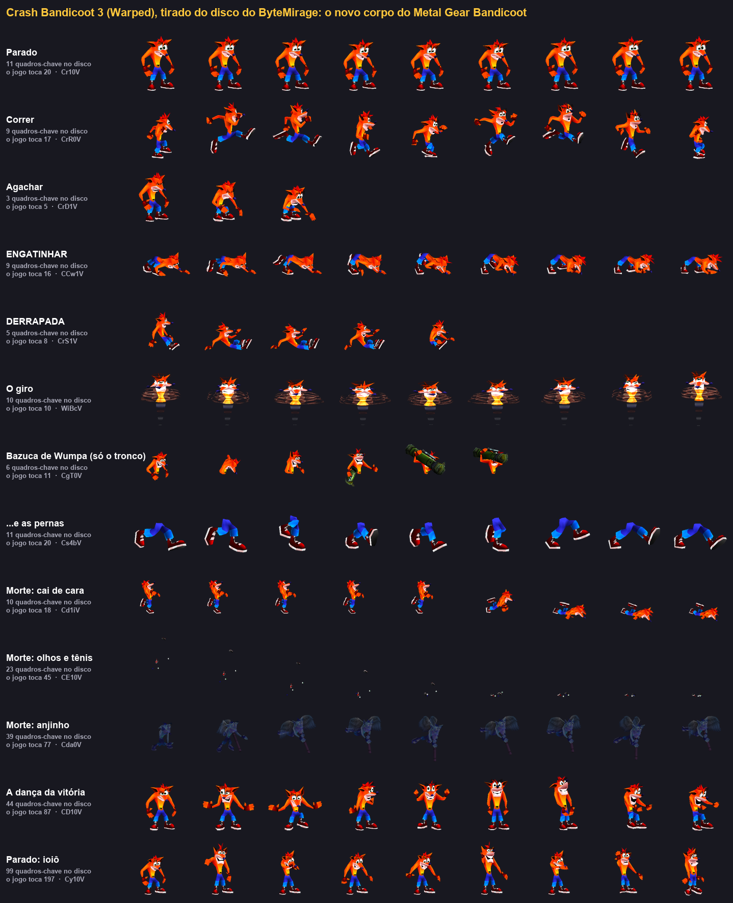

*O que o extrator tira do disco do Warped, desenhado por um programa que não abre o disco: só os arquivos extraídos.*

Quatro ideias sustentam tudo:

**1. O Metal Gear Solid é o mundo, e o Snake vira o corpo invisível do Crash.** O jogo é compilado a partir da descompilação do [FoxdieTeam](https://github.com/FoxdieTeam/mgs_reversing), com uma bandeira nova no motor gráfico: "calcula, mas não desenha". O Snake continua existindo, com controle, colisão, guardas e alerta; só não aparece. Tudo o que é nosso fica atrás de `#ifdef DEV_EXE`: sem a variante, a compilação continua batendo byte a byte com o jogo original.

**2. O Crash sai do disco dele, e nada é redesenhado.** O Crash não tem esqueleto: cada quadro de animação traz de novo a posição de todos os vértices. É por isso que ele estica e amassa daquele jeito, e é por isso que ele não cabe no formato de boneco articulado do Snake. Um extrator em Python ([`crash_assets/`](crash_assets/)) lê os arquivos do jogo e entrega modelo, animações, cores, texturas e sons num formato combinado entre os dois lados.

**3. Um ator novo desenha o Crash a cada quadro.** Ele olha o que o Snake está fazendo (parado, correndo, deitando, socando, levando tiro) e escolhe a animação do Crash que corresponde, descomprime os vértices, faz a média entre dois quadros vizinhos, como o próprio Warped faz, e monta os triângulos na posição e na direção do Snake.

**4. Tudo isso em 2 MB.** Quando o Crash entrou, sobravam 26 KB no Loading Dock. O que coube, coube assim: texturas, paletas e sons não ficam no executável, vão no fim de uma cópia de um arquivo do disco e são lidos uma vez por fase; os quadros são guardados em 10,3 bits por vértice, sem perda (o próprio Warped usa 14,3); a bazuca só vem do CD quando é sacada.

Em volta disso:

- **O robô de testes** ([`motor/harness/`](motor/harness/)): um emulador de PlayStation dirigido por script, que aperta botões, lê a memória pelo endereço do jogo e tira fotos. Foi com ele que cada teste foi conferido antes de chegar em mrxploud.
- **Dois Claudes.** Um ficou com o corpo (o lado do Metal Gear Solid: compilar, montar o disco, o ator em C). O outro com a alma (o lado do Crash: tirar tudo do disco e dizer como cada animação toca). Eles conversam por arquivos de texto, com um contrato escrito do formato da entrega, e um confere o trabalho do outro. Vários dos erros da jornada foram pegos assim.

---

## A jornada, passo a passo

Este projeto é de **[mrxploud](https://github.com/mrxploud)** ([ByteMirage](https://www.youtube.com/@ByteMirage)), feito em parceria com o **Claude**, a IA da Anthropic, do dia 10 para o dia 11 de outubro de 2026.

**A ideia da fusão, a escolha dos jogos, as decisões de rumo e os testes são de mrxploud.** A investigação, o código e os experimentos foram feitos por dois Claudes, sob essa direção. Cada etapa abaixo nasceu de um pedido de mrxploud ou de algo que ele achou jogando: o Crash flutuando, o engatinhar tremendo, a caixa com um lado faltando, a caixa do Aku Aku, a bazuca.

O que segue é o caminho real, incluindo os erros. O registro completo, com hora e prova de cada passo, está em [`diario/`](diario/).

### 1. A ideia

mrxploud pediu uma lista de jogos de PlayStation que já tinham sido descompilados e escolheu dois que talvez ficassem engraçados juntos: Metal Gear Solid e Crash Bandicoot. Por coincidência, achou o post de 2018 com o desenho do Max_Comix e os comentários. O plano: jogar com o Crash dentro do Metal Gear Solid, usando os projetos de descompilação para não sofrer tanto, com dois Claudes trabalhando ao mesmo tempo e guardando fotos, testes e bugs para um vídeo futuro.

### 2. Medindo o terreno

Os dois projetos não eram a mesma coisa. O [mgs_reversing](https://github.com/FoxdieTeam/mgs_reversing) é uma descompilação em C: o executável principal recompila igual ao original, e dá para mudar o jogo de verdade. O [CrashBandicoot-Launcher](https://github.com/Matteo842/CrashBandicoot-Launcher) é uma recompilação do código de máquina para C#: roda o jogo no PC, mas não é código-fonte legível.

Isso definiu a estratégia: o Metal Gear Solid seria o mundo, e do Crash só seria preciso entender os arquivos, não o programa.

### 3. Dois Claudes, o mesmo tropeço

Os dois começaram ao mesmo tempo, cada um na sua janela, e clonaram os mesmos repositórios em pastas diferentes com três minutos de diferença. Era o erro anotado desde o vídeo anterior para não repetir. Foi resolvido em cinco minutos: vale a pasta de quem chegou primeiro.

Logo depois, outro: os dois dividiam a mesma pasta de memória, e um apagou o índice do outro sem saber, deixando duas notas, uma dizendo "eu sou o Claude 1" e a outra "eu sou o Claude 2". A regra que ficou: só acrescentar, nunca reescrever.

### 4. Um CD de mentira

Os discos ainda não tinham chegado. Para não esperar parado, o Claude do lado Crash fabricou um CD de PlayStation de mentira em que o "Crash" era um cubo de 8 vértices, e passou ele pelo extrator inteiro. A primeira imagem do projeto é um cubo laranja de teto azul "respirando" em quatro quadros.

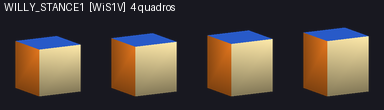

Quando o disco de verdade chegou, o leitor escrito só com o CD de mentira leu a primeira fase de primeira.

### 5. O Crash sai do disco

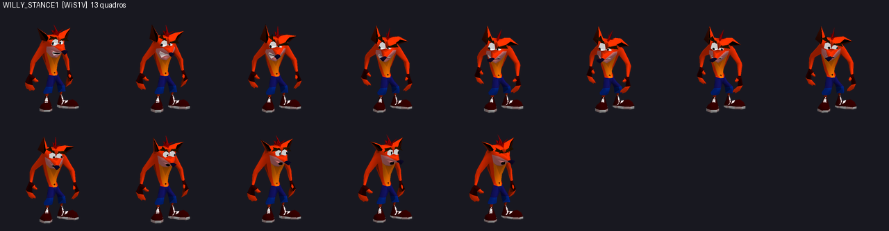

*Os 13 quadros do Crash parado, tirados do disco do Crash 1.*

No caminho, três descobertas:

- **Dentro do jogo o Crash se chama Willy**, de Willy the Wombat, o nome dele durante o desenvolvimento. Todas as animações são `WILLY_*`.
- **O giro não era a animação `FLIP`.** A tabela dizia que sim, deduzido pelo nome. Desenhada, `FLIP` era o Crash virando de lado; o giro é `BLOW`, um modelo à parte, um tornado com a cabeça dele no meio.
- **O "Woah!" foi achado sem ouvidos.** Os sons passaram por um programa de transcrição de fala. No "Woah!" ele ouviu "Wow"; no som do pulo, "Thanks for watching!".

### 6. O Crash aparece no Metal Gear Solid

Enquanto isso, o outro Claude fez o Metal Gear Solid compilar no Windows, montou o disco com o executável novo e escreveu o robô de testes.

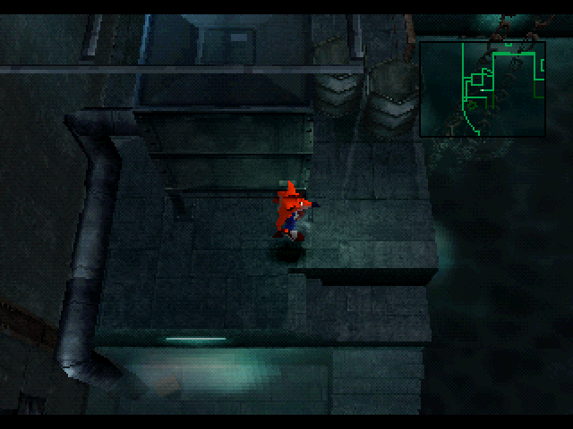

*A primeira vez que o Crash apareceu dentro do Metal Gear Solid: de pé e virado para o lado certo, de primeira.*

E veio o problema que acompanhou o projeto inteiro: **memória.** No Loading Dock sobravam 26 KB. O Crash inteiro tinha 2 MB de animações. O PlayStation tem 2 MB no total.

### 7. Meio passo

Lendo o script do Crash para decidir o que cortar, apareceu uma economia de 1996: **a corrida do Crash é só meio passo.** A Naughty Dog guardou uma perna e espelhou a outra. E o "parado" de verdade são 2 quadros, não 13. Só isso baixou de 82 KB para 55 KB; com compressão, 31 KB. Trinta anos depois, o mesmo truque salvou a memória do Crash dentro do Metal Gear Solid.

Até o Crash 1 sofria com isso: o script dele confere se há espaço e carrega do CD as animações da morte só na hora de morrer.

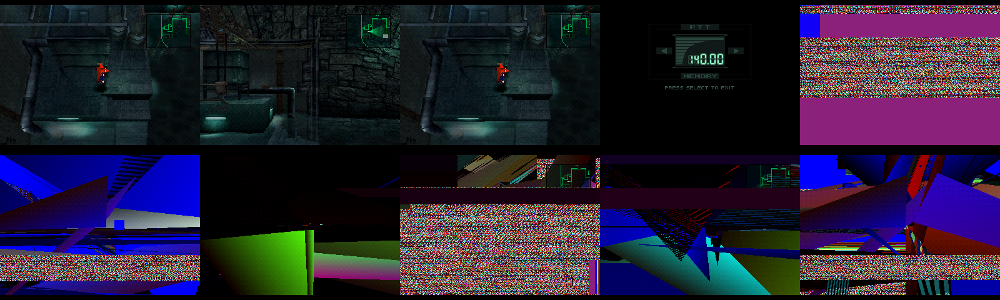

*O bug do dia: ao sair do rádio, a tela virava lixo. Uma chamada do Campbell usa a memória de pacotes inteira, e o Crash continuava escrevendo na parte dele, que já era de outro objeto.*

### 8. A caixa, o "WOAH!" e a TNT

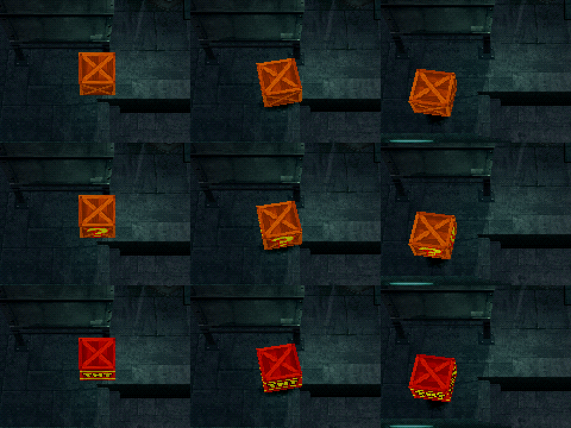

*A ideia do yuvi3000, de 2018: caixa A de madeira, caixa B "?", caixa C de TNT.*

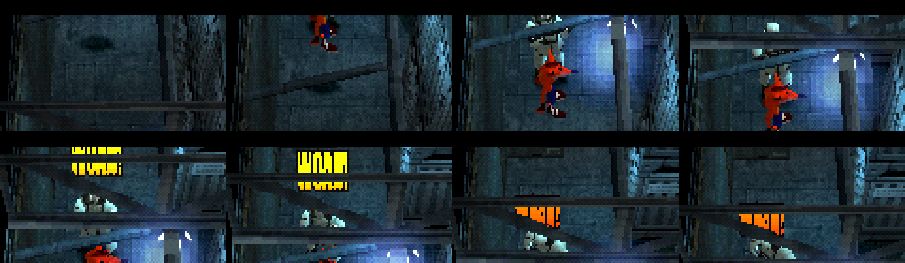

*O "!" virou "WOAH!". O som gravado do jogo passou pelo programa de transcrição, que ouviu: "Uau! Uau!".*

No caminho apareceu um bug do próprio Metal Gear Solid: o modo de desenho com descarte de costas do motor dele só funciona com quadriláteros; com triângulos ele copia o segundo vértice no lugar do terceiro. A caixa ficou invisível até ser desenhada com código nosso.

Depois veio a TNT: o guarda acha a caixa parada, chuta, ela desliza contando 3, 2, 1 com o bipe do Crash, e explode.

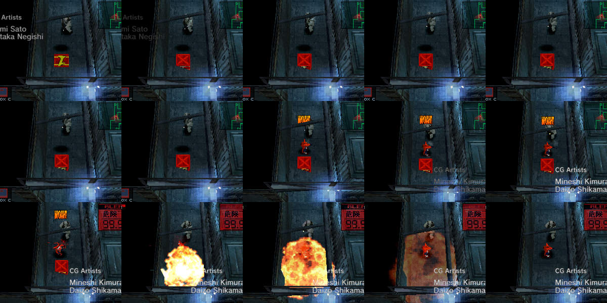

### 9. O primeiro retorno: "o Crash está flutuando"

mrxploud jogou e devolveu três coisas. A primeira era um bug que a câmera de cima escondia: o Crash não estava com os pés no chão.

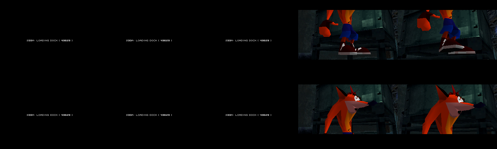

*Em cima, a câmera baixa da abertura mostrando os tênis do Crash na altura da cintura do Snake. Embaixo, depois do conserto.*

A causa foi achada lendo o código: o ponto em que o Crash estava pendurado não é o chão, é a cintura do Snake.

A segunda era um pedido: o Crash andar agachado e derrapar. Conferindo no disco, **o Crash 1 não tem nenhum dos dois**; eles só entraram na série no Crash 2. A saída do momento foi improvisar com o que havia: as pernas da corrida coladas num corpo abaixado.

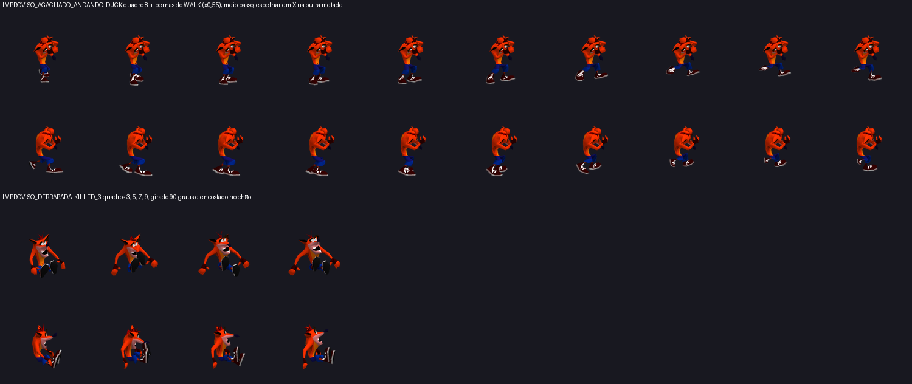

### 10. Trocando de jogo no meio

mrxploud olhou os improvisos e tomou a decisão que mudou o projeto: **usar o Crash Bandicoot 3**, que tem agachar, engatinhar e derrapar de verdade.

O formato do Warped é outro, e para ele não existe descompilação com nomes. Tudo o que se sabe do formato veio de ler o código do [CrashEdit](https://github.com/cbhacks/CrashEdit), do CBHacks. O modelo vem em "fita" de triângulos; a animação não vem em bytes, vem numa fila de bits em que cada vértice é a diferença para o anterior.

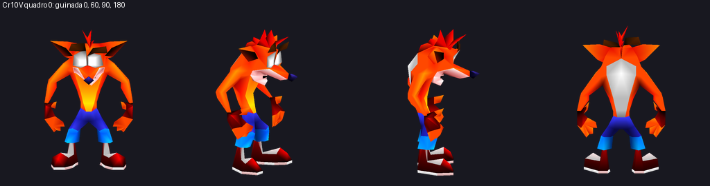

*O Crash 3 saiu do disco de primeira: 305 vértices, 574 triângulos, ainda de olhos brancos.*

Duas surpresas boas: o Crash 3 tem **menos** vértices que o Crash 1 (305 contra 381), e o disco guarda só **metade dos quadros**; o jogo inventa os do meio fazendo a média. E uma curiosidade: dois jogos depois, ele ainda se chama Willy.

Trinta e nove minutos depois da decisão, o Crash do Warped estava dentro do Metal Gear Solid.

### 11. O que mais havia no disco

Identificando as 92 animações do Crash pelas prévias, apareceram a dança da vitória, o ioiô, a morte em que sobram só os olhos e os tênis, e alguns erros:

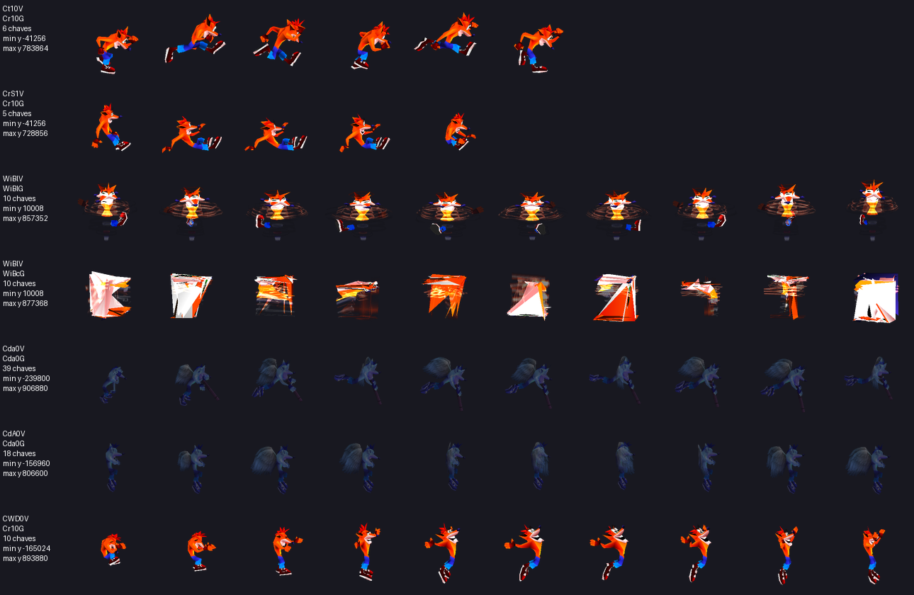

*Na quarta linha, o giro "leve" desenhado com a animação do giro "pesado": 248 vértices lendo uma fila de bits feita para 435.*

- O Aku Aku saiu deitado e o "TNT" da caixa de lado: nos modelos pequenos os bytes vêm numa ordem, nos comprimidos em outra.
- O Windows não distingue maiúsculas de minúsculas em nome de arquivo, e o Warped tem entradas que só diferem nisso (`CdsiV` e `CdSiV`). Uma gravou por cima da outra. Quem pegou foi um conferidor que relê a extração inteira sem abrir o disco.

### 12. O teste 5 e três bugs

mrxploud jogou o Crash 3 e devolveu três bugs e dois pedidos.

**O engatinhar tremia.** Na tabela estava escrito que o engatinhar era um laço. Medindo os quadros, não era: as 9 chaves são **meio ciclo**, e a última é o espelho da primeira, exatamente como a corrida do Crash 1. Voltar da última para a primeira sem espelhar dava um tranco de um quinto da altura dele, duas vezes por segundo. E a animação batizada de "engatinhar parado" era a passagem de agachado para de quatro: em laço, ele pulava entre as duas poses.

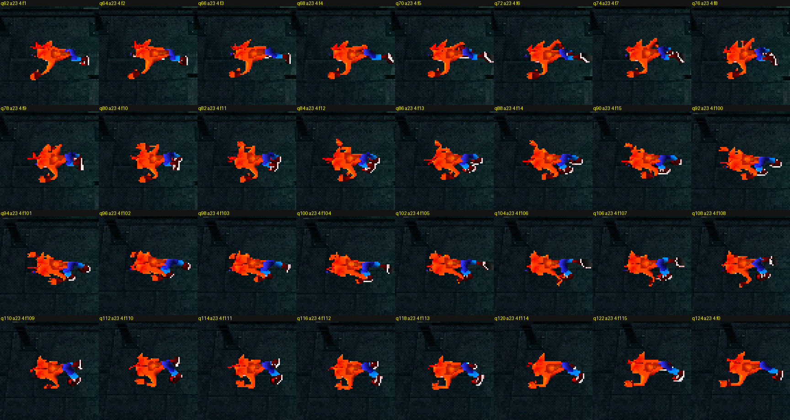

**A caixa tinha um lado faltando.** O primeiro palpite foi o fundo. Medindo as faces: frente, lados, tampa e fundo existem. **A caixa do Crash 1 não tem as costas**, porque a câmera do Crash 1 nunca passa para trás de uma caixa. Em 1996 ninguém ia ver; dentro do Metal Gear Solid a câmera deu a volta, e mrxploud viu.

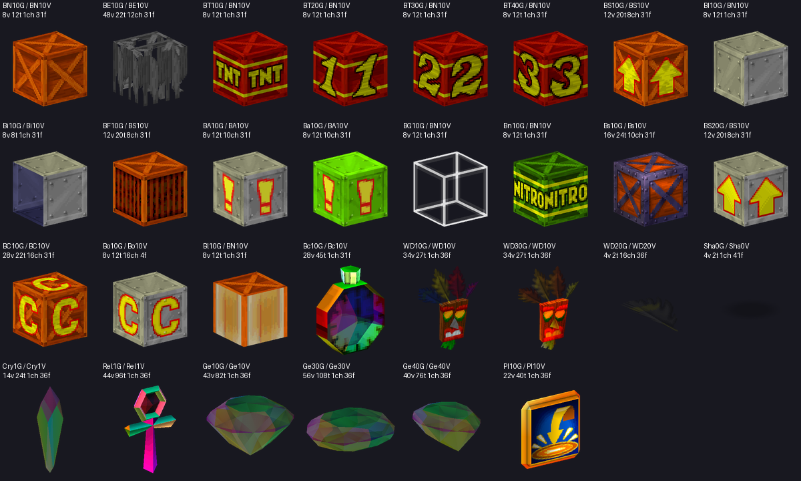

*As caixas do Warped têm as seis faces. A "?", a do Aku Aku e a da vida são a mesma caixa de madeira com outra "cara".*

**Correr + agachar não derrapava.** No MGS1 esse comando não tem mergulho nenhum: o Snake agacha e deita. A derrapada ganhou um estado novo do Snake.

### 13. O Aku Aku

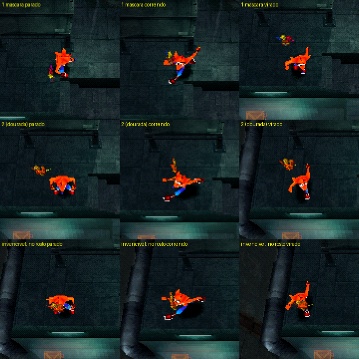

As rações do Dock viraram caixas do Aku Aku. Um detalhe: a cara da máscara na caixa é a única textura de 256 cores do conjunto, e a área de vídeo livre do Metal Gear Solid não comporta essa paleta. Reduzida para 16 cores do jeito comum, a pena azul virava verde. A solução foi escolher as cores dando o mesmo peso a cada cor diferente, e não a cada pixel: a pena azul é pequena, mas é uma cor que só ela tem.

### 14. A bazuca: o Crash cortado ao meio

O Warped tem a bazuca de Wumpa. O primeiro modelo apontado como "a bazuca" eram **só as pernas do Crash**, calça e tênis, andando sozinhas. Depois virou "uma morte em que sobram as pernas". As duas vezes errado pela metade: quando o Crash usa a bazuca, o jogo **corta ele ao meio**. Um modelo é o tronco com a bazuca no ombro, o outro são as pernas, para ele mirar para um lado e andar para o outro.

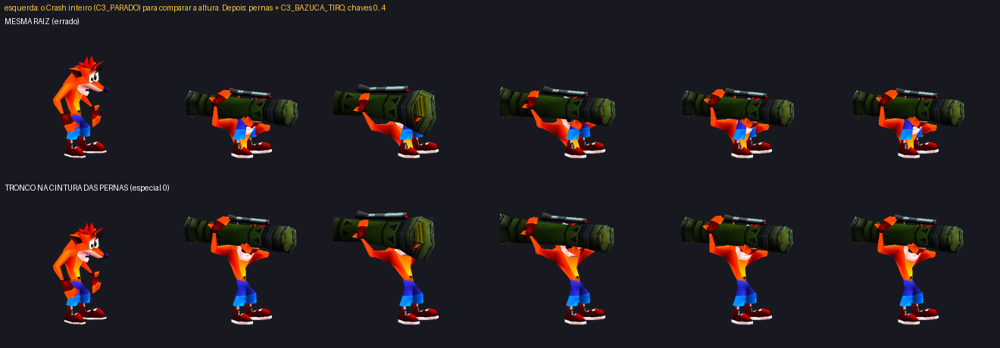

*Em cima, as duas metades "na mesma origem": um anão. Embaixo, o tronco pendurado no ponto da cintura das pernas. As cinco colunas da direita são o coice do tiro.*

Aqui a lição do teste 5 foi aplicada antes do bug: medindo antes de responder, apareceu que a animação batizada de "mira" era o **coice do tiro** (em laço, ele daria coice sem parar) e que o tronco não fica na origem das pernas. O outro Claude contou depois que a primeira montagem dele tinha exatamente esses dois erros.

O som do tiro também foi achado sem ouvir: o script da bazuca cita três sons, e eles existem exatamente nas mesmas 15 fases em que a bazuca existe. Qual dos três é o disparo foi decidido pelo formato da onda.

### O que essa jornada ensinou

- **Nome não é prova. Prévia não é prova. Medida é.** O giro que não era `FLIP`, a bazuca que eram pernas, o laço que era meio ciclo, a mira que era coice: todo erro de dados deste projeto veio de descrever uma coisa pelo nome ou pela aparência. Os que foram medidos antes não viraram bug.
- **Os jogos antigos economizam onde a câmera não vê.** Meio passo espelhado, metade dos quadros, uma caixa sem as costas. Colocar o personagem em outro jogo é mudar a câmera, e as economias aparecem.
- **Um conferidor que não confia no autor.** O programa que relê a extração sem abrir o disco pegou um arquivo sobrescrito na primeira rodada. Os dois Claudes mediram o tranco do engatinhar cada um do seu lado e chegaram no mesmo número.
- **Quem joga vê o que o robô não vê.** O Crash flutuando, o tremor, o lado da caixa: os três foram achados por mrxploud jogando, não pelos testes automáticos.

---

## Os formatos do Crash

Para quem quiser os detalhes:

| O quê | Onde |
|---|---|
| Visão geral do lado Crash e o que cada disco ensinou | [`crash_assets/LEIA-ME.md`](crash_assets/LEIA-ME.md) |
| Modelo e animação do Crash 3 (fita de triângulos, fila de bits) | [`crash_assets/crashlib/formatos3.py`](crash_assets/crashlib/formatos3.py) |
| O decodificador de referência dos quadros do Warped, em 30 linhas | [`crash_assets/ver3.py`](crash_assets/ver3.py), função `descomprimir` |
| Que animação do Crash toca em cada ação do Snake, e como cada uma emenda | [`crash_assets/TABELA_SNAKE_CRASH3.md`](crash_assets/TABELA_SNAKE_CRASH3.md) |
| O mesmo para o Crash 1 (testes 1 a 4) | [`crash_assets/TABELA_SNAKE_CRASH.md`](crash_assets/TABELA_SNAKE_CRASH.md), [`crash_assets/ESTUDO_COMPRESSAO.md`](crash_assets/ESTUDO_COMPRESSAO.md) |
| O que mudou no Metal Gear Solid | [`mgs/LEIA-ME.md`](mgs/LEIA-ME.md) |
| O plano original | [`PLANO.md`](PLANO.md) |

Os nomes `C3_*` das animações do Warped são apelidos nossos, dados olhando as prévias ([`crash_assets/nomes_c3.json`](crash_assets/nomes_c3.json)). O nome de verdade de cada uma é o da entrada no disco.

---

## Estrutura do projeto

```
crash_assets/      o lado Crash
  extrair3.py        tira o Crash do disco do Warped
  extrair.py         tira o Crash do disco do Crash 1
  ver3.py            confere e desenha a extração sem abrir o disco
  crashlib/          leitor de CD, do contêiner do jogo, dos formatos, e o desenhista das prévias
  testes/            o teste com o CD de mentira
motor/             o lado Metal Gear Solid
  empacotar_crash3.py  escreve o Crash em C para dentro do jogo
  montar_disco.py      troca o executável do disco original pelo nosso
  jogar.py             a janela de jogo
  harness/             o robô de testes
mgs/               o que mudamos no Metal Gear Solid (patch + arquivos novos)
diario/            a linha do tempo, os bugs e as ideias, com hora e prova
docs/img/          as imagens deste texto
discs/ repos/      vazias; cada uma tem um LEIA-ME dizendo o que colocar
```

Pastas criadas ao rodar e nunca publicadas: `crash_assets/out/` e `out_c3/` (o que sai dos discos), `motor/out/` (os discos montados), `motor/disco_mgs/` (o disco original extraído). As fotos que o diário cita ficam em `diario/img/`, que também não é publicada; as escolhidas estão em `docs/img/`.

---

## Comunidade

Dúvidas, bugs, ideias e novidades do projeto:

- **Discord:** <https://discord.com/invite/4H5hGwVnPn>
- **YouTube:** <https://www.youtube.com/@ByteMirage>

## Créditos e avisos

A lista completa, com o que cada um fez, está em [`CREDITOS.md`](CREDITOS.md).

- _Metal Gear Solid_ © Konami. _Crash Bandicoot_ © Sony Interactive Entertainment / Naughty Dog / Activision. Este é um projeto de fã, sem fins lucrativos e sem ligação com as empresas.
- As capturas de tela mostram os jogos originais e estão aqui apenas para ilustrar o texto.
- **A inspiração:** o desenho "Metal Gear Bandicoot: Wumpa Fruit Eater", de **u/Max_Comix**, e os comentários do post: **yuvi3000** (a caixa do Crash), **ZXE102R** e dois usuários hoje apagados (o "Woah!" e os assistentes de laboratório).
- **[FoxdieTeam](https://github.com/FoxdieTeam):** o [mgs_reversing](https://github.com/FoxdieTeam/mgs_reversing), a descompilação do Metal Gear Solid: Integral, e o [psyq_sdk](https://github.com/FoxdieTeam/psyq_sdk). É o Metal Gear Solid que compilamos e modificamos.
- **[CBHacks](https://github.com/cbhacks):** o [CrashEdit](https://github.com/cbhacks/CrashEdit). Todo o formato do Crash 3 foi aprendido lendo o código dele.
- **[wurlyfox](https://github.com/wurlyfox):** o [c1](https://github.com/wurlyfox/c1), de onde vieram os formatos do Crash 1.
- **[ManDude](https://github.com/ManDude):** o [goocdump](https://github.com/ManDude/goocdump), os scripts do Crash 1 com nome.
- **[Matteo842](https://github.com/Matteo842):** o [CrashBandicoot-Launcher](https://github.com/Matteo842/CrashBandicoot-Launcher), e **[BlackLabelHQ](https://github.com/BlackLabelHQ)**, o [RecompOne](https://github.com/BlackLabelHQ/RecompOne) em que ele se apoia.
- A emulação é feita pelo núcleo [PCSX ReARMed](https://github.com/libretro/pcsx_rearmed) do libretro, e o disco é remontado com o [mkpsxiso](https://github.com/Lameguy64/mkpsxiso). Nenhum dos dois é distribuído aqui.
- **Ideia, direção e testes:** [mrxploud](https://github.com/mrxploud) ([ByteMirage](https://www.youtube.com/@ByteMirage)).
- **Investigação e código:** Claude, da Anthropic, pelo [Claude Code](https://claude.com/claude-code), sob a direção de mrxploud.
